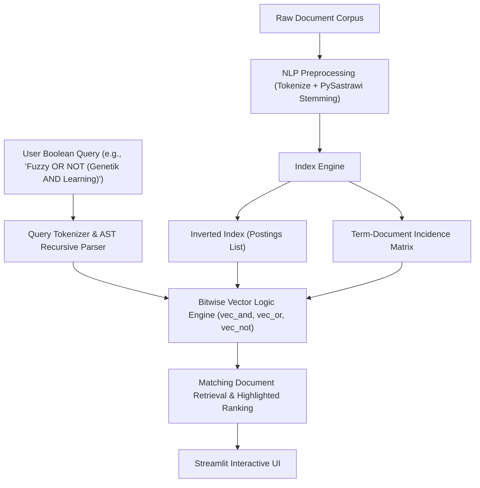

<div align="center">

# 🔍 Boolean IR Engine
### *Indonesian Information Retrieval System with AST Query Parser & Sastrawi NLP*

[](https://www.python.org/)
[](https://streamlit.io/)
[](https://github.com/harispraba/PySastrawi)
[](https://pandas.pydata.org/)
[](LICENSE)

<p align="center">
  Mesin pencari teks berbasis <b>Boolean Retrieval Model</b> yang dirancang khusus untuk korpus berbahasa Indonesia. Mengimplementasikan parser ekspresi boolean berbasis rekursif (mendukung tanda kurung bertingkat), konstruksi <i>Inverted Index</i> dan <i>Term-Document Incidence Matrix</i>, serta antarmuka web interaktif modern berbasis Streamlit.
</p>

</div>

---

## 📌 Latar Belakang & Pendekatan Teknis

Dalam temu kembali informasi (*Information Retrieval*), model pencarian Boolean adalah fondasi penting yang memanfaatkan teori himpunan dan logika matematika (*Exact Match*).

Proyek ini dibangun dari nol (*from scratch*) tanpa menggunakan library pencarian instan, guna mendemonstrasikan algoritma inti temu kembali informasi:
1. **Pipeline NLP Bahasa Indonesia:** Tokenisasi, normalisasi tanda baca, dan *morphological stemming* menggunakan algoritma Sastrawi.
2. **Indexing Ganda:**
   * **Inverted Index:** Menyimpan daftar *postings list* dokumen yang memuat setiap lema/term kata.
   * **Incidence Matrix:** Matriks biner dimensi tinggi $(V \times D)$ untuk operasi vektor logika bitwise.
3. **AST Recursive Query Parser:** Mampu mengevaluasi ekspresi boolean kompleks bertingkat dengan operator logika `AND`, `OR`, `NOT`, serta pengelompokan menggunakan tanda kurung `( ... )`.
4. **Visualisasi Alur Logika (Step-by-step Evaluation):** Menampilkan bagaimana vektor kebenaran biner dihitung pada setiap tahap evaluasi query.

---

## 🏗️ Alur Arsitektur Sistem



---

## 🌟 Fitur Utama

* **⚡ Boolean Logic Evaluator:** Mendukung ekspresi boolean arbitrer:
  * `termA AND termB`
  * `termA OR termB`
  * `NOT termA`
  * `termA AND (termB OR NOT termC)`
* **📑 Dual View Index Explorer:** Menjelajahi representasi matriks insidensi maupun kamus indeks terbalik (*inverted index*) secara visual melalui tabel interaktif.
* **🎨 Modern Streamlit Dark Dashboard:** Antarmuka responsif dengan tipografi *Plus Jakarta Sans* dan visualisasi hasil pencarian dokumen yang terstruktur.
* **🔬 Transparansi Perhitungan:** Menampilkan vektor bitwise hasil dari tiap operasi sub-ekspresi agar pengguna memahami alasan mengapa suatu dokumen terpilih.

---

## 💻 Contoh Penggunaan Query

Sistem mendukung format query kapital untuk operator:

| Contoh Query | Logika Pencarian |
| :--- | :--- |
| `fuzzy AND clustering` | Dokumen harus memuat kedua kata tersebut. |
| `genetik OR neural` | Dokumen memuat minimal salah satu dari kedua kata. |
| `NOT optimasi` | Dokumen yang sama sekali tidak memuat kata optimasi. |
| `fuzzy OR NOT (genetik AND learning)` | Kombinasi operator bersarang dengan tanda kurung. |

---

## 🛠️ Tech Stack & Struktur Kode

* **Bahasa:** Python 3.10+
* **Web UI Framework:** [Streamlit](https://streamlit.io/)
* **Indonesian NLP Stemmer:** [PySastrawi](https://github.com/harispraba/PySastrawi)
* **Data Processing:** [Pandas](https://pandas.pydata.org/)

### Struktur Repositori
```
├── app.py                # Aplikasi antarmuka Streamlit utama
├── indexing.py           # Logika pembuat Inverted Index & Incidence Matrix
├── ir_model.py           # Parser AST Boolean Query & eksekutor logika bitwise
├── preprocessing.py      # Normalisasi teks & pipeline stemming Sastrawi
├── corpus/               # Kumpulan dokumen teks sumber
├── docs/                 # Spesifikasi & dokumentasi teknis
└── requirements.txt      # Daftar dependensi Python
```

---

## ⚡ Panduan Menjalankan Secara Lokal

### Prasyarat
Pastikan Python 3.10 atau versi yang lebih baru telah terpasang di sistem Anda.

### Langkah-langkah

1. **Clone Repositori:**
   ```bash
   git clone https://github.com/dekbintang/Tugas-STKI.git
   cd Tugas-STKI
   ```

2. **Buat Virtual Environment (Disarankan):**
   ```bash
   # Windows
   python -m venv venv
   .\venv\Scripts\activate

   # Linux / macOS
   python3 -m venv venv
   source venv/bin/activate
   ```

3. **Instal Dependensi:**
   ```bash
   pip install -r requirements.txt
   ```

4. **Jalankan Aplikasi Web:**
   ```bash
   streamlit run app.py
   ```
   Aplikasi akan otomatis terbuka pada peramban web di alamat: `http://localhost:8501`

---

## 📄 Lisensi
Proyek ini dilisensikan di bawah [Lisensi MIT](LICENSE).
